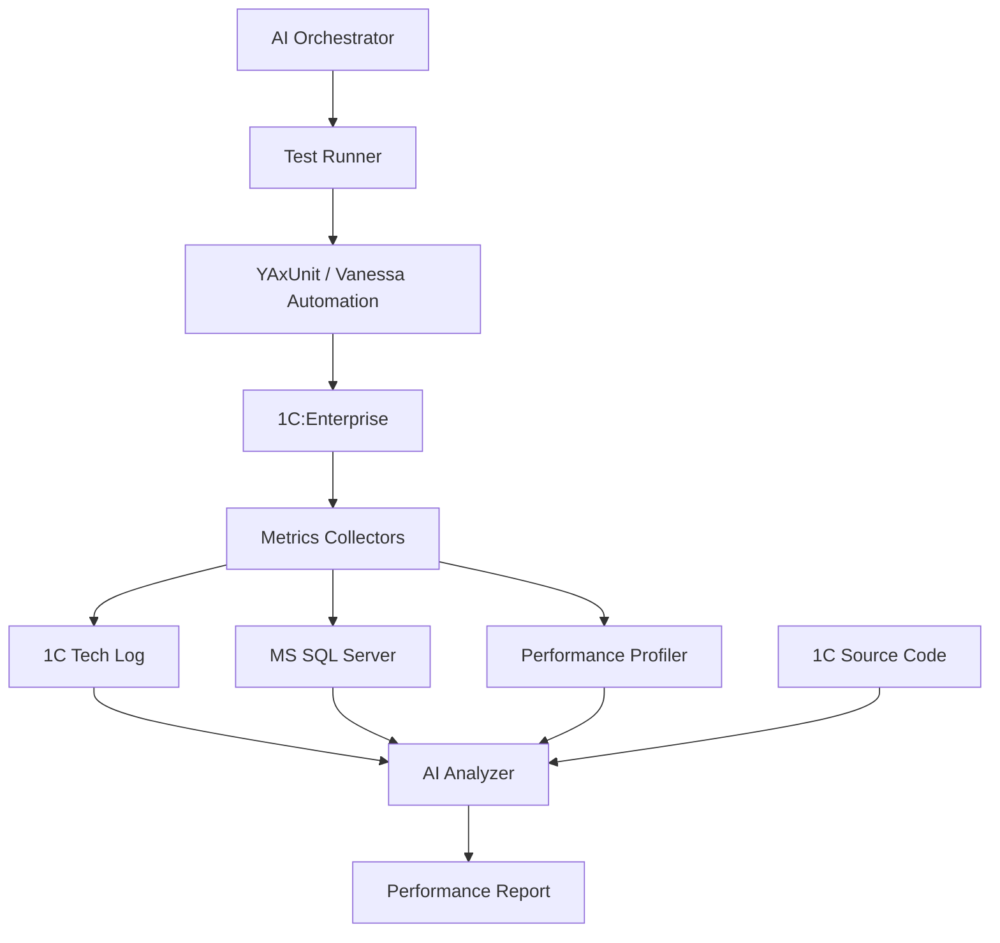

# onec-perf-agent — ИИ-агент анализа производительности 1С

**AI-powered performance testing and profiling agent for 1C:Enterprise.**

ИИ-агент для оркестрации тестирования, анализа производительности и выявления неоптимального кода и SQL-запросов в системах на платформе **1С:Предприятие**.

## Возможности (планируются)

- Запуск и оркестрация тестов **YAxUnit** и **Vanessa Automation**.
- Сбор и анализ технологического журнала 1С.
- Анализ статистики выполнения и планов запросов **MS SQL Server**.
- Обработка результатов замеров производительности 1С.
- Сопоставление метрик с исходным кодом конфигурации.
- Поиск узких мест и формирование рекомендаций по оптимизации.
- Генерация отчётов с приоритетами и подтверждающими метриками.

## Верхнеуровневая архитектура

Оркестратор управляет выполнением тестов и сбором диагностики. Анализатор сопоставляет метрики с исходниками, выявляет проблемные участки и формирует отчёт. Конкретные способы интеграции будут определены в ходе исследования.

## MVP

1. Запуск тестового сценария и фиксация параметров прогона.
2. Сбор метрик 1С и MS SQL Server.
3. Выявление наиболее затратных операций и запросов.
4. Привязка найденных проблем к исходному коду, где это позволяют диагностические данные.
5. Формирование отчёта с метриками, гипотезами причин и рекомендациями.

## Статус

**Planning / Research** — проект находится на этапе проработки.

> Принцип проекта: выводы о производительности должны опираться на измерения; гипотезы ИИ отделяются от подтверждённых проблем.
